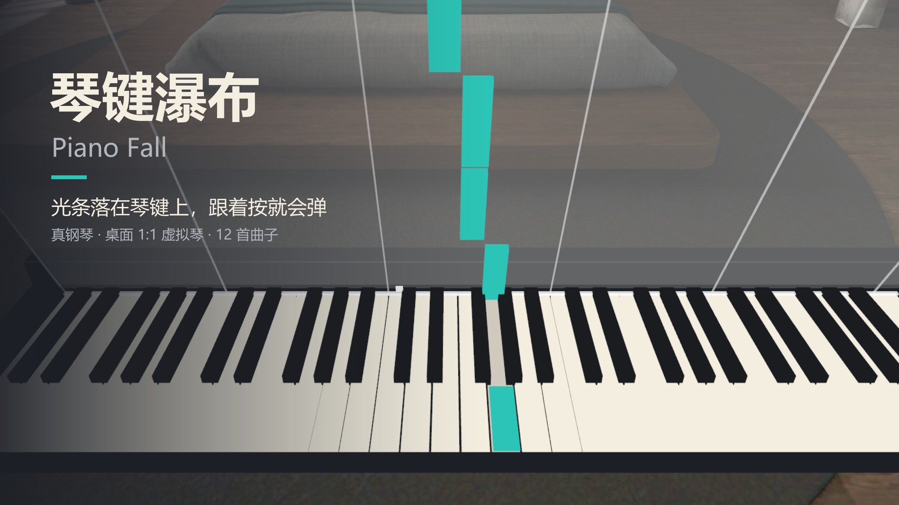
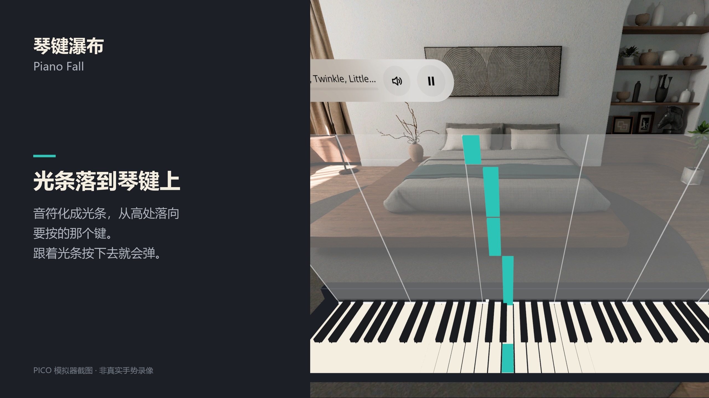
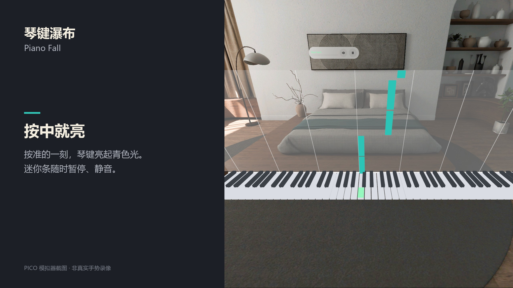
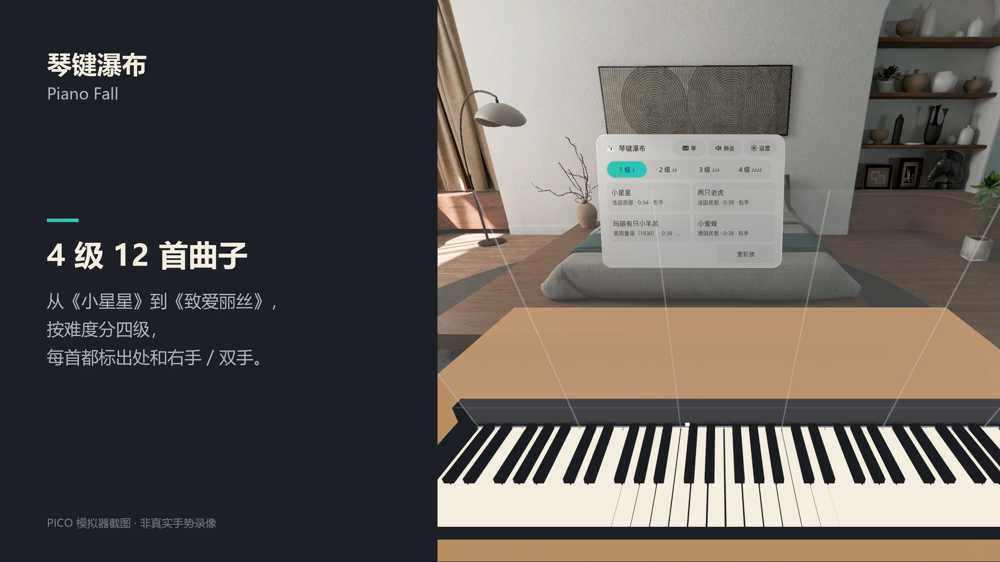
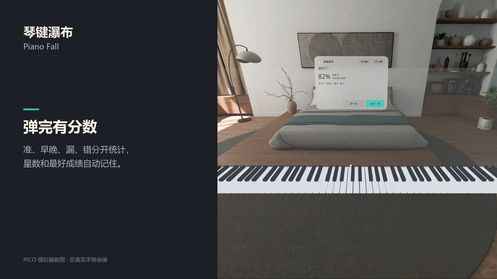
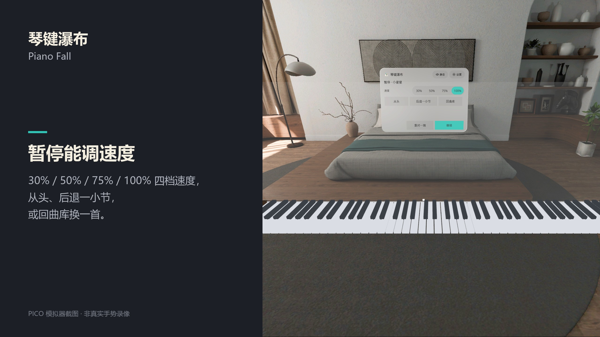
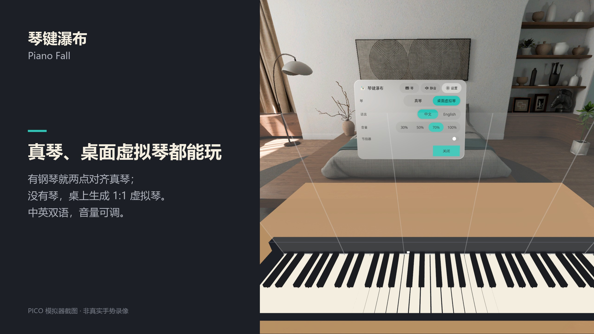

# 琴键瀑布 Piano Fall



[中文](#中文) · [English](#english)

---

## 中文

PICO OS 6 空间钢琴练习应用。音符化成光条，从高处落向要按的那个键，跟着按下去就会弹。坐到自家钢琴前，或者在桌上放一台 1:1 的虚拟琴，都能用。

### 功能

- **真钢琴**：用手柄前端或食指点琴键最左、最右两个角完成对齐，标准键数（88 / 76 / 73 / 61 / 49）自动吸附；两个世界锚点，下次打开还在原处。插 USB MIDI 线可以用「等我按」模式。
- **桌面虚拟琴**：没有琴就找一张桌子（5 秒找不到就用虚拟桌面），手柄射线把 1:1 虚拟琴摆上去。用指尖碰桌面按键，或用手柄射线 / 前端按键，Salamander 钢琴采样发声。
- **三种玩法**：听一遍、跟着走（打分、星数、最好成绩）、等我按（按对了才往下走）。四档速度，另一只手可以自动弹。
- **12 首公版曲子，分 4 级**：从《小星星》《两只老虎》到《欢乐颂》《卡农》《致爱丽丝》《月光奏鸣曲》开头。
- **v0.1.2 新增**
  - 虚拟琴按键辅助：设置里选 轻松 / 标准 / 精确。会吸附到该按的音，要求从上往下按才算，防抖；判定窗口放宽，和弦允许先后按下。
  - 连击（combo）和 Perfect / Good 评价；按中时手柄轻震。
  - 侧面板固定在房间里，不再跟着头走。拖面板下方的把手可以挪位置，点「拉到眼前」把它叫回正前方。
- 中英双语，有静音键，全部本机运行，不联网、不需要账号。

### 截图

| | |
|---|---|
|  |  |
|  |  |
|  |  |

截图来自 PICO 模拟器，由调试广播驱动，**不是真实手势录像**。截图拍的是 v0.1.0 / v0.1.1 的界面，v0.1.2 新增的按键辅助设置、连击评价和面板拖动把手没有拍进去。

### 安装

从 [Releases](https://github.com/kejing-dev/PianoFall/releases) 下载 APK，然后：

```bash
adb install -r PianoFall-v0.1.2.apk
pico-cli app launch io.embodit.pianofall
```

需要 PICO OS 6 设备（Swan）。应用运行在 Full Space（混合现实，透视画面）。

### 构建

Kotlin，PICO Spatial SDK 6.1.9。

```bash
./gradlew assembleDebug
```

结构说明见 [AGENTS.md](AGENTS.md)。

### 许可

- 钢琴采样：Salamander Grand Piano V3，Alexander Holm，CC-BY 3.0
- 字体：Noto Sans / Noto Sans SC，SIL OFL 1.1
- 曲谱：全部为公版作品，出处和改编说明见 `app/src/main/assets/LICENSES.md` 和 `domain/Songs.kt`

---

## English

A PICO OS 6 spatial piano trainer. Notes turn into light bars that fall onto the key you need to press. Press along and you are playing. Use it at your own piano, or put a 1:1 virtual piano on your desk.

### Features

- **Your own piano**: touch the leftmost and rightmost key corners with the controller tip or your index finger. The length snaps to a standard key count (88 / 76 / 73 / 61 / 49), and two world anchors keep the keyboard in place next time. With a USB MIDI cable you also get "Wait for me" mode.
- **Virtual desk piano**: no piano? The app finds a desk (or gives you a virtual one after 5 seconds) and you place a 1:1 piano with the controller ray. Press keys with your fingertips on the desk, or with the controller ray or tip. Sound comes from Salamander piano samples.
- **Three modes**: Listen, Play along (score, stars, best score), and Wait for me (the song moves on only when you hit the right note). Four speeds, and the other hand can play itself.
- **12 public-domain songs in 4 levels**, from Twinkle Twinkle and Frère Jacques to Ode to Joy, Canon, Für Elise and the opening of the Moonlight Sonata.
- **New in v0.1.2**
  - Virtual-key assist with an Easy / Standard / Precise setting. It snaps to the wanted note, only counts presses that come from above, and debounces. Timing windows are wider, and the notes of a chord may come in one after another.
  - Combo with Perfect / Good ratings, plus a short controller buzz on a hit.
  - The side panel stays fixed in the room instead of following your head. Drag the handle under it to move it, or tap "Bring here" to recall it in front of you.
- Chinese and English, a mute button, fully offline, no account needed.

### Screenshots

See the table above. The screenshots come from the PICO emulator driven by debug broadcasts, **not real hand recordings**. They show the v0.1.0 / v0.1.1 UI. The v0.1.2 assist setting, combo ratings and panel drag handle are not in them.

### Install

Download the APK from [Releases](https://github.com/kejing-dev/PianoFall/releases), then:

```bash
adb install -r PianoFall-v0.1.2.apk
pico-cli app launch io.embodit.pianofall
```

Requires a PICO OS 6 device (Swan). The app runs in Full Space (mixed reality, passthrough).

### Build

Kotlin, PICO Spatial SDK 6.1.9.

```bash
./gradlew assembleDebug
```

See [AGENTS.md](AGENTS.md) for the code layout.

### Credits

- Piano samples: Salamander Grand Piano V3 by Alexander Holm, CC-BY 3.0
- Fonts: Noto Sans / Noto Sans SC, SIL OFL 1.1
- Scores: all public-domain works; sources and arrangement notes are in `app/src/main/assets/LICENSES.md` and `domain/Songs.kt`
